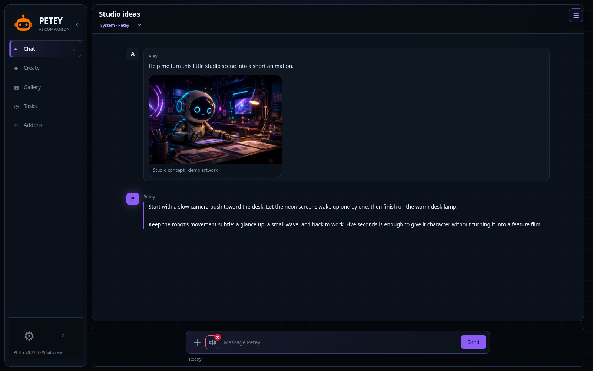
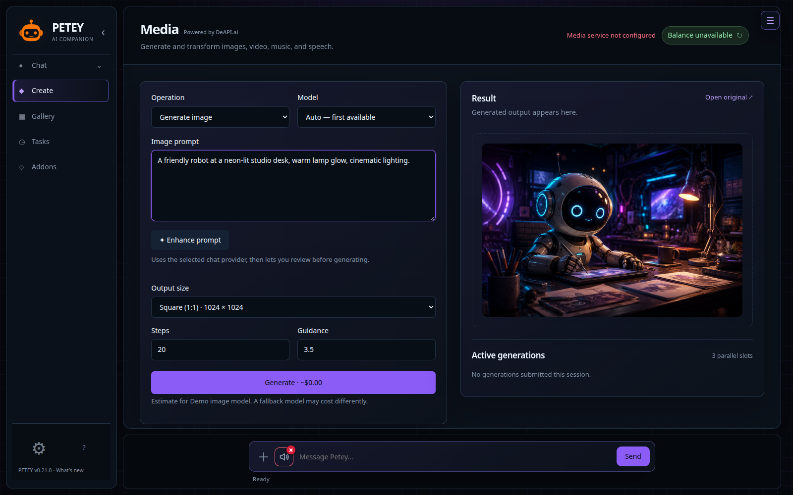
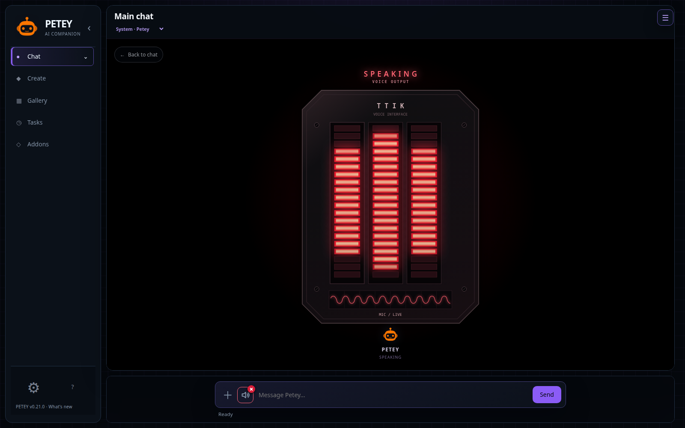
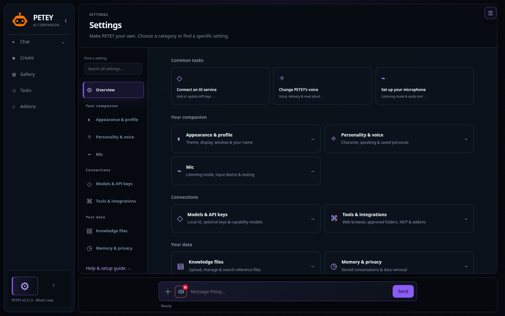
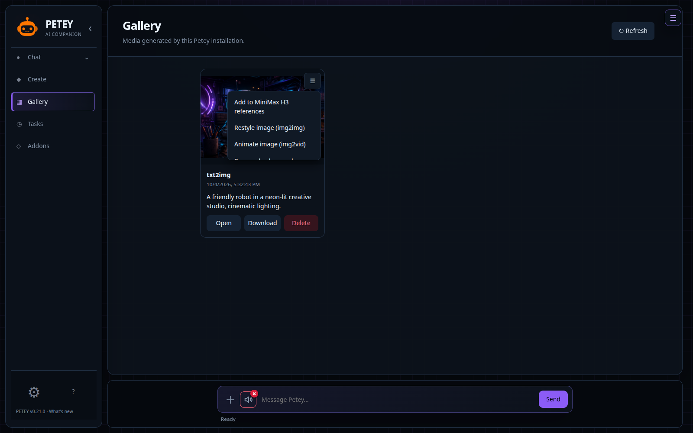

# PETEY

Current version: **v0.19.1** · Previous experimental preview: **v0.19.0-experimental.1** · [Release notes](CHANGELOG.md)

**[Read the PETEY Wiki](https://github.com/bizzomephisto/PETEY-DESKTOP/wiki)**

PETEY is a standalone desktop AI assistant with local conversations, configurable
personality, universal SQLite memory, RAG document management, deAPI media tools,
voice conversation, visual mode, and optional integrations.

## Preview



| Media studio | Audio-reactive visual mode |
| --- | --- |
|  |  |

| Settings | Gallery actions |
| --- | --- |
|  |  |

## Character creation and roleplay

PETEY can be shaped into an original character, narrator, companion, game master,
or collaborative writing partner—not just a general-purpose assistant. Customize
the character's name, role, tagline, behavior, speaking style, and voice, then save
the complete instructions, traits, communication style, voice, and speech provider
in one of five Petey profile slots.

- Keep separate chats for different characters, campaigns, worlds, or storylines.
- Add lore, character sheets, setting notes, and campaign documents to the local
  RAG library so a character can retrieve relevant details while you play.
- Use saved memory to maintain continuity across sessions, or enable Temporary
  mode for scenes that should not affect the character's ongoing history.
- Talk naturally with push-to-talk, an always-on microphone, or wake-name mode,
  and let the selected voice read the character's responses aloud.
- Use Visual Mode for a voice-reactive, distraction-free performance view.
- Pair roleplay with media tools to create character art, locations, music, voices,
  and animated scenes from the same desktop application.

Because the chat provider is selectable, a character can run through Gemini,
OpenAI, or a compatible local model depending on the desired quality, privacy,
speed, and hardware setup.

## Highlights

- Gemini, OpenAI, LM Studio, Ollama, and other OpenAI-compatible chat providers
- Local SQLite conversation memory with source labels, correction-aware retrieval, and configurable local or hosted embeddings
- Temporary chats that do not read or write memory
- Chat deletion can permanently remove its messages or preserve them as searchable memory
- Built-in personality templates, editable system prompts, and five complete Petey profile slots
- RAG uploads, retrieval testing, vector rebuilding, and local database controls
- Parallel image, video, music, speech, background-removal, and upscale jobs
- Streaming Gemini text to speech with OpenAI fallback, named voices, and delivery direction
- Per-reply Speak controls and optional automatic playback for new chat responses
- Hosted or private Local Whisper transcription for push-to-talk, always-on, and wake-name microphone input
- Replaceable per-voice wake acknowledgements that play only after the wake name is followed by a pause
- Adjustable wake acknowledgement, silence-to-send, and follow-up listening timing
- Keyboard Space push-to-talk and four audio-reactive neural-network chat views
- Quick PETEY popup at the cursor with chat, screenshots, files, and push-to-talk
- Streaming chat responses with progress states, interruption handling, and final-only memory storage
- Live Gemini, OpenAI, and local-server model catalogs with stale-request protection
- F11 visual fullscreen with progressive captions during Petey's spoken replies
- Real deAPI progress, provider status, live previews, balance, and a local gallery
- Per-operation media prompt drafts that remain available across app restarts
- Conversational image generation through modular model tools
- Gemini image inspection using the selected Gemini chat model
- Visual thumbnail browser for selecting source images
- Multiple saved chats, UI scaling, collapsible navigation, and always-on-top mode
- Per-chat saved Petey profiles with visible header assignment, system-persona fallback, and jump-to-latest navigation
- Read-only Filesystem MCP tools scoped to folders approved under Settings → Tools
- [Discord bot bridge](docs/discord.md) with online Gateway presence, deAPI media slash commands, startup auto-connect, AI-enhanced room prompts, adaptive participation, watched topics, and approved channel-management proposals
- [Add-on system](docs/addons.md) with explicit enablement, lifecycle hooks, API routes, sidebar panels, shared desktop services, and model-tool extensions
- User-triggered update checks and confirmed installs for PETEY and repository-declared add-ons, with add-on data preserved
- Reorganized Settings overview with grouped categories, cross-page search, section links, compact layouts, and a catalog-driven page structure

The GitHub release includes only PETEY's built-in Discord integration. Third-party
and locally developed add-ons are installed separately in PETEY's application-data
folder and are not bundled with the source release.

### Official external add-ons

- [Home Assistant MCP](https://github.com/bizzomephisto/PETEY-HOME-ASSISTANT) — inspect exposed Home Assistant entities, teach PETEY household names, and control devices through review or trust mode.
- [Petey Life](https://github.com/bizzomephisto/PETEY-LIFE) — give the active persona an editable pixel home with autonomous, directed, and build modes.

Each add-on repository provides a ready-to-install release archive. Install them
through PETEY's **Add-ons** screen; they remain independently versioned and are not
included in PETEY Desktop source archives.

The same screen can check for PETEY and add-on updates. PETEY installs only a clean
fast-forward from the official Git checkout. Add-ons opt in through their manifest's
GitHub repository field and install from a validated ZIP on the latest release.

PETEY normally runs a loopback-only Flask server inside a pywebview desktop
window. If a native backend is unavailable, the launcher can open the same
interface in your browser. An explicit, private-link LAN mode can share the
interface with your phone while PETEY is running.

## Requirements

- Python 3.12 or newer
- FFmpeg for browser-compatible generated-video previews
- A language-model provider: Gemini, OpenAI, or a local OpenAI-compatible server
- A Gemini API key if you want image inspection, Gemini speech, or microphone transcription fallback
- A deAPI key if you want media generation or microphone transcription
- Node.js with `npx` if you want to enable the Filesystem tool
- OpenSSL if you want trusted HTTPS phone access and live phone microphone capture

Manage keys and service models in **Settings → Models & API keys**. Gemini,
OpenAI, local-server, and deAPI keys can be saved independently of the active chat
provider. Existing environment keys remain supported. Voice identity and delivery
settings stay under **Personality & voice**.

Connected capabilities are managed under **Settings → Tools**. Filesystem uses a
pinned release of the official MCP server and receives only folders you add there.
Petey exposes its read, list, metadata, and search tools;
filesystem writes, moves, and deletes remain unavailable.

## Install and run

```bash
git clone https://github.com/bizzomephisto/PETEY-DESKTOP.git
cd PETEY-DESKTOP
python3 -m venv .venv
source .venv/bin/activate
pip install -r requirements.txt
cp .env.example .env
python run_desktop.py
```

On Windows, activate the environment with `.venv\Scripts\activate`. For browser-based development, run:

```bash
python run_desktop.py --browser
```

On Linux, the requirements install the PySide6 backend for pywebview. Do not run
`pip install gi`; PyGObject is supplied through Linux distribution packages.

Install PETEY in your Linux application menu with:

```bash
python run_desktop.py --install-shortcut
```

On the COSMIC desktop, install the **Super+F1** Quick PETEY shortcut with:

```bash
python run_desktop.py --install-quick-hotkey
```

Quick PETEY opens beside the mouse pointer and focuses its message box. Press
Enter to send, hold Space while the empty message box is focused to talk, use
the Screen or Window buttons to attach a capture, and press Escape to close it.
The Window button opens COSMIC Screenshot so you can select the window. Run
`python run_desktop.py --quick` directly to use a different shortcut manager.

### Open PETEY on your phone

For a complete walkthrough covering local Wi-Fi, a permanent Cloudflare domain,
and a free temporary Cloudflare address, see
**[Mobile and remote access](docs/wiki/Mobile-and-Remote-Access.md)**.

Connect the phone and computer to the same trusted network, then run:

```bash
python run_desktop.py --lan
```

PETEY prints a private URL using the computer's LAN address and port `8765`.
Open that complete URL on the phone. The secret is exchanged for a browser cookie
and removed from the address bar. Keep the URL private: it grants access to PETEY
until the server stops or the browser cookie expires. Use `--port 9000` to choose a
different port if necessary.

The phone layout is intentionally focused: text chat, the visual
animation, and a compact settings sheet. Mobile settings expose only the saved
Petey profile, current speech voice, microphone method (open mic, wait for “Petey”, or push to talk),
and animation style; fullscreen is a direct control on the visual page. Provider, media, add-on, and advanced
settings remain on PETEY Desktop.

For a real fullscreen hold-to-talk button without the phone keyboard, use trusted
HTTPS:

```bash
python run_desktop.py --lan-https
```

On the first run, PETEY generates a private local certificate authority and prints
an HTTP setup link. Open it on the phone, download the public PETEY certificate,
and follow the page's iPhone/iPad or Android trust instructions. Return to the
computer and press Enter; PETEY switches the same port to HTTPS and prints the
private HTTPS link. Allow microphone access when the phone browser asks. Later
`--lan-https` launches reuse the trusted authority and go directly to HTTPS.

To install the certificate on another phone or show the setup page again, run:

```bash
python run_desktop.py --lan-https --install-lan-certificate
```

The CA private key remains mode `0600` under PETEY's application-data `lan-tls/`
folder and is never served to the network. Keep that folder private: a device that
trusts this CA will trust certificates created with its private key.

If the phone cannot connect, allow the selected TCP port through the computer's
firewall and confirm the Wi-Fi does not isolate wireless clients. In Visual mode,
trusted HTTPS enables the fullscreen hold-to-talk control. Plain HTTP falls back
to a message field that can use the phone keyboard's speech-to-text microphone.

To reach PETEY through an existing named Cloudflare Tunnel, set its public
hostname and local origin port in `.env`:

```dotenv
PETEY_CLOUDFLARE_HOSTNAME=petey.example.com
PETEY_CLOUDFLARE_PORT=8765
```

In the Cloudflare tunnel route, point that hostname to
`http://localhost:8765`. Then run:

```bash
python run_desktop.py --cloudflare
```

PETEY opens its normal desktop window, listens only on the configured loopback port, and leaves the existing
`cloudflared` service in charge of the tunnel. Cloudflare supplies the public HTTPS
certificate, while the local origin remains inaccessible from the LAN. PETEY creates
one durable private pairing link and prints it at every launch. Open it once on a
phone to create a one-year HttpOnly, SameSite, Secure cookie; the bare hostname
returns `401`. The pairing survives PETEY restarts. To revoke every paired browser
and replace the link, launch once with `--cloudflare --rotate-mobile-access`.
Keep a Cloudflare Access policy in front of PETEY as an additional identity check.

To make the installed PETEY application launcher start this Cloudflare mode, run:

```bash
python run_desktop.py --install-shortcut --cloudflare --cloudflare-hostname meetpetey.com
```

The launcher saves the resolved Cloudflare hostname and port in its launch command.
The top-right chat menu can restart PETEY in the current mode, a normal desktop
window, Cloudflare plus desktop, or a browser. PETEY preserves a known Cloudflare
hostname and port in its private application data while switching modes. If no
hostname has been saved yet, choosing Cloudflare plus desktop asks for it. The `--install-shortcut` option only
updates the launcher; it does not start PETEY.

For a free temporary address without a Cloudflare account or domain, start PETEY
and `cloudflared` in two terminals as described in
**[Mobile and remote access](docs/wiki/Mobile-and-Remote-Access.md#free-temporary-cloudflare-address)**.
The generated `trycloudflare.com` URL changes each time and should be treated as a
private access link.

Application artwork is available under `assets/icons/` as a transparent PNG
master, Linux PNG, Windows ICO, and macOS ICNS file.

Provider keys and models can be configured from **Settings**. Values saved there
are stored in PETEY's platform application-data directory. Environment variables
from `.env` are also supported.

## Getting started and help

Open **Help** in PETEY's sidebar for a first-chat checklist, provider setup,
voice and microphone guidance, media, memory, tools, and troubleshooting.
The API keys section in Settings also links directly to this guide.

- **Gemini:** [Get a key in Google AI Studio](https://aistudio.google.com/apikey)
  ([official guide](https://ai.google.dev/gemini-api/docs/api-key)).
- **OpenAI:** [Create an API key](https://platform.openai.com/api-keys)
  ([official guide](https://developers.openai.com/api/docs/quickstart)).
- **deAPI:** [Open the dashboard](https://app.deapi.ai/) and use Settings → API Keys
  ([official guide](https://docs.deapi.ai/quickstart)).

Save each key in **Settings → Models & API keys → API keys**. Choose your chat
provider and model, click **Save provider**, then **Test connection**. Add other
services as needed; review provider pricing and account limits before use.

## Updating

Close PETEY, open a terminal in its project folder, and activate its environment.
If you have local code changes, commit or stash them before updating:

```bash
git pull --ff-only
python -m pip install -r requirements.txt
python run_desktop.py
```

On Linux, run `python run_desktop.py --install-shortcut` again after moving the
project or changing its Python environment so the menu launcher uses the new paths.

## Local data and privacy

PETEY stores its installation identity, settings, memory database, and generated
gallery in the platform application-data directory—not in this repository. Use
temporary chat when a conversation should not be retained.

When a hosted chat or embedding provider is selected, relevant prompts, selected
file context, or memory text are sent to that provider. Local-provider
mode keeps those model requests on the configured local endpoint. Chat image
attachments are sent to the independently selected Gemini vision model, and its
text description is passed to the active chat provider. Microphone activity and
the wake name are detected locally; completed recordings use the selected hosted
or Local Whisper transcription path. Install the optional private
engine with `.venv/bin/python -m pip install faster-whisper`, then explicitly
download a model under Settings → Models & API keys → Speech recognition.
Recordings are not stored in the gallery or memory. Media-generation requests are
sent to deAPI.

## Filesystem safety

PETEY's optional Filesystem connector is restricted to folders you explicitly add
under Settings → Tools. Only read, list, metadata, and search capabilities are
offered to the model. It does not expose write, move, delete, or shell-command tools.

## Development

For coding agents, start with [AGENTS.md](AGENTS.md), the compact architecture,
task-to-file map, extension guide, and validation reference. Read
[PETEY_MANIFEST.md](PETEY_MANIFEST.md) for durable product/runtime/release
invariants and [ADDONS.md](ADDONS.md) before extension work. Many agents load the
root-level `AGENTS.md` automatically. For any other tool, paste:

> Read `AGENTS.md` in the project root first, then implement my request. Use its
> task-to-file map to inspect only relevant code and tests; update it if your
> changes alter the documented architecture or workflows.

Run the test suite with:

```bash
python -m unittest discover -s tests -v
```

Core layout:

- `run_desktop.py` — desktop launcher and native-window bridge
- `petey/assistant.py` — provider-neutral conversation service
- `petey/desktop_memory.py` — local SQLite memory and RAG store
- `petey/desktop_state.py` — installation settings and saved chats
- `petey/deapi_client.py` — deAPI transport and progress polling
- `petey/media_jobs.py` — concurrent generation queue and gallery capture
- `petey/tools/` — permission-aware model tool registry and capability modules
- `web/desktop_app.py` — loopback Flask API
- `web/templates/desktop.html` and `web/static/desktop.*` — desktop interface
- `petey/quick_window.py` — cursor-anchored compact interface
